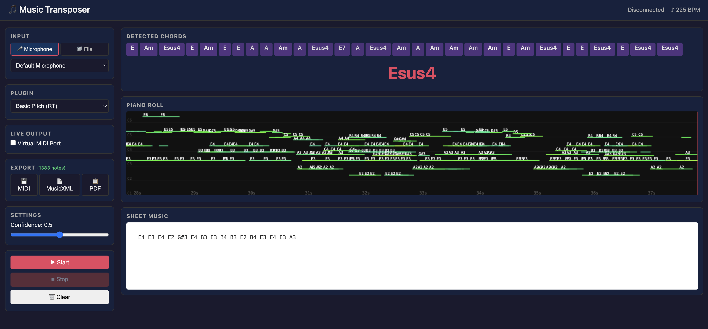

# Music Transposer

Offline audio-to-score transcription app. Listens to audio from a file or microphone,
detects notes and chords using local ML models, and outputs MIDI, MusicXML, PDF, or
streams to a virtual MIDI port — all running locally with no cloud dependencies.

## Features

- **Polyphonic note detection** — detects multiple simultaneous notes (piano, guitar)
- **Chord recognition** — groups notes into chords (major, minor, 7th, dim, aug, sus, etc.)
- **Multiple input modes** — file upload (WAV/MP3/FLAC) or live microphone
- **Multiple output formats** — MIDI file, MusicXML, PDF sheet music, virtual MIDI port
- **Real-time visualization** — piano roll, chord timeline, sheet music (VexFlow)
- **Plugin architecture** — swap transcription models without changing code
- **Cross-platform** — runs on Mac and Raspberry Pi 5



## Quick Start (Mac)

```bash
# Install everything
./scripts/install_mac.sh

# Run
source venv/bin/activate
python -m app.main
```

Open http://localhost:5050 in your browser.

## Quick Start (Raspberry Pi 5)

```bash
./scripts/install_pi.sh
source venv/bin/activate
python -m app.main
```

Open http://<pi-ip>:5050 in a browser on any device on the same network.

## Built-in Plugins


| Plugin            | Description                                                           | Real-time     |
| ----------------- | --------------------------------------------------------------------- | ------------- |
| **Basic Pitch**   | Spotify's polyphonic AMT model. Best accuracy for single instruments. | Yes (chunked) |
| **Chroma Chords** | Lightweight chromagram-based chord detection. Fast.                   | Yes           |

## Adding Custom Plugins

Drop a `.py` file in the `plugins/` directory. See `plugins/README.md` for the template.

## Architecture

```
Audio Input → Preprocessor → Transcription Plugin → Output Router
  ├─ Mic                      ├─ BasicPitchPlugin     ├─ MIDI File
  └─ File                     └─ ChromaChordPlugin    ├─ Virtual MIDI Port
                                                       ├─ MusicXML
                                                       ├─ PDF (LilyPond)
                                                       └─ WebSocket → UI
```

## Dependencies

- Python 3.11+
- [Basic Pitch](https://github.com/spotify/basic-pitch) (Spotify)
- librosa, sounddevice, mido, python-rtmidi, music21
- Flask + Socket.IO
- LilyPond (optional, for PDF export): `brew install lilypond`

## Environment Variables

- `MT_HOST` — bind address (default: `0.0.0.0`)
- `MT_PORT` — port (default: `5050`)
- `MT_DEBUG` — enable debug mode (default: `false`)
